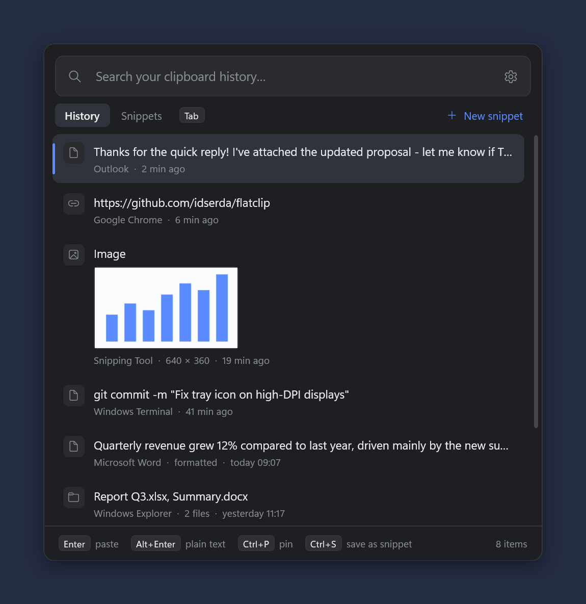

# FlatClip

A lightweight, keyboard-driven clipboard manager for Windows with a flat design and dark mode.

FlatClip runs quietly in the system tray and remembers everything you copy: text (including rich text / HTML formatting), images and files copied in Explorer. Press a hotkey, type to search, hit Enter to paste.

<p align="center">
  
</p>

## Features

- **Clipboard history**: text, rich text, images and files, kept for a configurable number of days (default 7)
- **Instant search**: the search box is focused as soon as the popup opens; multiple words must all match
- **Paste with or without formatting**: `Enter` pastes as copied, `Shift+Enter` pastes plain text
- **Snippets**: named, reusable texts (e.g. `email` → your email address) that never expire and show up at the top of search results
- **Pinning**: pinned history items never expire
- **Configurable hotkey**: default `Alt+Shift+V`
- **Dark, light or system theme**
- **Privacy-minded**:
  - history is stored encrypted with Windows DPAPI, so only your Windows account can read it
  - content marked by password managers as "do not record" (`ExcludeClipboardContentFromMonitorProcessing`, `CanIncludeInClipboardHistory = 0`) is skipped
- **Start with Windows**: optional
- **No installer, no runtime to install**: a single small `.exe` on .NET Framework 4.8, which ships with Windows

## Keyboard shortcuts

| Key | Action |
|---|---|
| `Alt+Shift+V` (configurable) | Open / close the popup |
| *type* | Search |
| `↑` `↓` `PgUp` `PgDn` | Navigate |
| `Enter` / double-click | Paste |
| `Shift+Enter` | Paste without formatting |
| `Tab` | Switch between *History* and *Snippets* |
| `Ctrl+P` | Pin / unpin history item |
| `Ctrl+S` | Save history item as snippet |
| `Ctrl+N` | New snippet |
| `Ctrl+E` / `F2` | Edit snippet |
| `Shift+Del` | Delete item (press twice for snippets) |
| `Esc` | Close |

## Language

The UI is in English, or in Dutch when the Windows display language is Dutch. To override this, set `"Language"` in `settings.json` to `"en"` or `"nl"` (default `"auto"`) and restart FlatClip.

Translations live in `src/Strings.cs`. To add a language, add a column there. XAML files use `{{Key}}` placeholders.

## Building

Requirements:
- Windows 10/11 (.NET Framework 4.8 is built in)
- The Roslyn C# compiler (`csc.exe`) from Visual Studio or the free [Visual Studio Build Tools](https://visualstudio.microsoft.com/downloads/#build-tools-for-visual-studio-2022). The build script locates it via `vswhere`.

```powershell
.\build.ps1
# -> bin\FlatClip.exe
```

There is no project file or NuGet dependency. `build.ps1` generates the app icon (`tools/MakeIcon.cs`) and compiles `src/*.cs`. The XAML files are embedded as resources and loaded at runtime.

## Usage

Run `bin\FlatClip.exe`. It appears in the system tray. The tray icon's menu has *Open*, *Pause recording*, *Settings* and *Exit*.

Running the exe again while it is already running opens the popup. `FlatClip.exe --settings` opens the settings window.

## Data locations

| What | Where |
|---|---|
| History (encrypted) | `%LOCALAPPDATA%\FlatClip\history.dat` + `images\` |
| Settings | `%APPDATA%\FlatClip\settings.json` |
| Snippets (plain JSON, so don't store secrets) | `%APPDATA%\FlatClip\snippets.json` |
| Error log | `%LOCALAPPDATA%\FlatClip\error.log` |

## Known limitations

- **Pasting into elevated windows**: pasting into apps running as administrator only works when FlatClip runs elevated too (Windows UIPI).
- **Hotkey conflicts with keyboard hooks**: tools that use a low-level keyboard hook take the hotkey before FlatClip sees it, and FlatClip cannot detect this. PowerToys *Advanced Paste* is one example. If the popup doesn't open, change the hotkey in either app.

## Project structure

```
src/
  App.cs                 startup, tray icon, clipboard listener, hotkey
  ClipboardIO.cs         reading / writing clipboard formats
  ClipEntry.cs           history item model
  Store.cs               encrypted history persistence, retention
  Snippets.cs            snippet model + storage
  PopupController.cs     main popup (search, list, paste)
  SettingsController.cs  settings window
  SnippetEditor.cs       snippet create/edit dialog
  Settings.cs            settings, hotkey parsing, autostart, theming
  Strings.cs             UI strings (English / Dutch)
  Native.cs              Win32 interop (hotkeys, SendInput, clipboard listener)
  *.xaml                 UI (loaded at runtime)
tools/MakeIcon.cs        generates the .ico at build time
build.ps1                build script
```

## License

[MIT](LICENSE)
